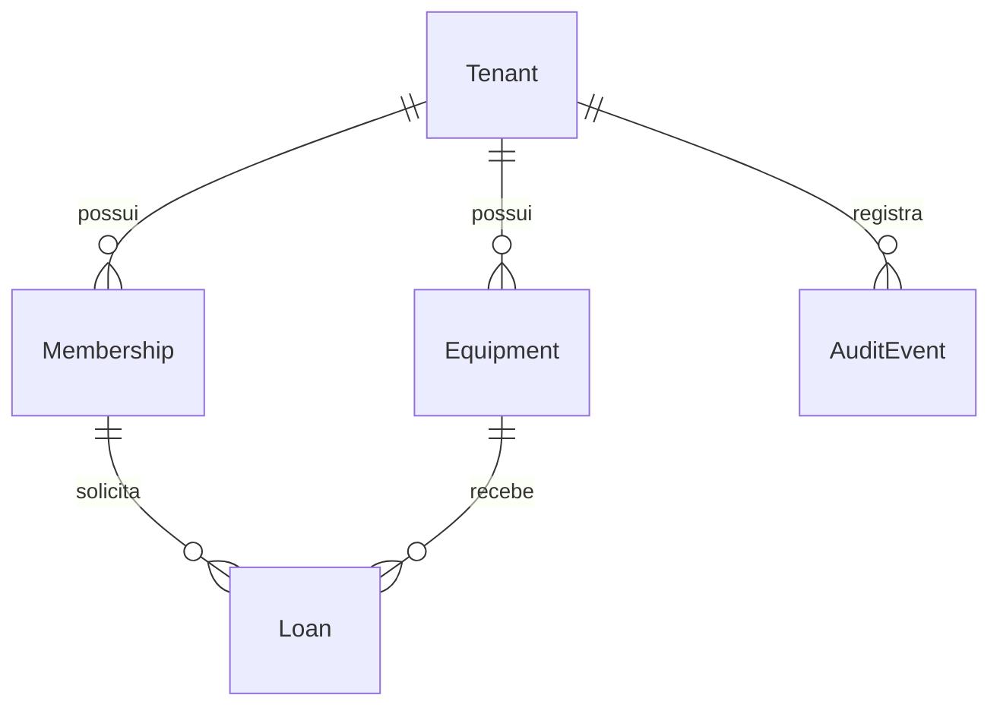

# Modelagem inicial do banco de dados

Esta documentação descreve a primeira modelagem do sistema de empréstimo de
equipamentos, derivada de `docs/PRD.md`, do ADR-001 e das migrations Prisma
existentes.

A fonte executável do schema continua sendo `prisma/schema.prisma` junto do
histórico em `prisma/migrations`. O arquivo `initial-model.snapshot.sql` é
somente uma fotografia consolidada para leitura e revisão.

## Entidades

### Tenant

Representa a organização proprietária dos dados. Todas as tabelas de domínio
são isoladas por `tenant_id`.

| Campo  | Tipo  | Regra             |
| ------ | ----- | ----------------- |
| `id`   | UUID  | chave primária    |
| `slug` | texto | único globalmente |
| `name` | texto | obrigatório       |

### Membership

Relaciona uma identidade do Supabase Auth a um tenant e define seu papel. Não
armazena senha, token ou dados de autenticação.

| Campo       | Tipo   | Regra                            |
| ----------- | ------ | -------------------------------- |
| `tenant_id` | UUID   | FK para `Tenant` e parte da PK   |
| `user_id`   | UUID   | ID de `auth.users` e parte da PK |
| `role`      | `Role` | `COLLABORATOR` ou `ADMIN`        |

### Equipment

Representa um equipamento disponível no catálogo interno.

| Campo       | Tipo              | Regra                                  |
| ----------- | ----------------- | -------------------------------------- |
| `id`        | UUID              | chave primária                         |
| `tenant_id` | UUID              | FK para `Tenant`                       |
| `assetTag`  | texto             | único dentro do tenant                 |
| `name`      | texto             | nome de exibição                       |
| `category`  | texto             | notebook, monitor, cabo, câmera etc.   |
| `status`    | `EquipmentStatus` | `AVAILABLE`, `LOANED` ou `MAINTENANCE` |
| `createdAt` | timestamptz       | preenchido na criação                  |

### Loan

Registra a retirada e a devolução de um equipamento.

| Campo         | Tipo        | Regra                                         |
| ------------- | ----------- | --------------------------------------------- |
| `id`          | UUID        | chave primária                                |
| `tenant_id`   | UUID        | participa das FKs compostas                   |
| `equipmentId` | UUID        | equipamento do mesmo tenant                   |
| `userId`      | UUID        | membership do mesmo tenant                    |
| `issuedAt`    | timestamptz | instante da retirada                          |
| `dueAt`       | timestamptz | posterior a `issuedAt`                        |
| `returnedAt`  | timestamptz | nulo enquanto aberto; nunca antes da retirada |

Um índice único parcial impede dois empréstimos abertos para o mesmo
equipamento. O prazo de 14 dias, o limite de três empréstimos e o bloqueio por
atraso são validados pelo service dentro da transação de empréstimo.

### AuditEvent

Registra ator, tenant, ação, recurso e momento das operações relevantes.
Trigger de banco impede atualização, exclusão e truncamento, mantendo a tabela
append-only.

| Campo        | Tipo        | Regra                  |
| ------------ | ----------- | ---------------------- |
| `id`         | UUID        | chave primária         |
| `tenant_id`  | UUID        | FK para `Tenant`       |
| `actorId`    | UUID        | identidade responsável |
| `action`     | texto       | ação executada         |
| `resourceId` | UUID        | recurso afetado        |
| `createdAt`  | timestamptz | instante do evento     |

## Relacionamentos

As foreign keys de `Loan` incluem `tenant_id`, impedindo relacionamentos entre
usuários e equipamentos de tenants diferentes.

## Regras do PRD

| Regra do produto                         | Responsável pela garantia                 |
| ---------------------------------------- | ----------------------------------------- |
| Cada pessoa vê os próprios empréstimos   | consulta filtrada por tenant e `user_id`  |
| No máximo três itens abertos             | service transacional                      |
| Prazo padrão de 14 dias                  | service de política                       |
| Pessoa com atraso não pega outro item    | service de política                       |
| Item em manutenção não fica disponível   | `EquipmentStatus` e service               |
| Um item não tem dois empréstimos abertos | índice único parcial no PostgreSQL        |
| Operações visualiza empréstimos abertos  | `Membership.role` e índice de empréstimos |
| Isolamento entre organizações            | chaves compostas, filtros de tenant e RLS |

## Fora desta modelagem

Não existem tabelas de reserva futura, notificação por e-mail ou importação
da planilha, pois esses itens estão fora da primeira versão do PRD.
